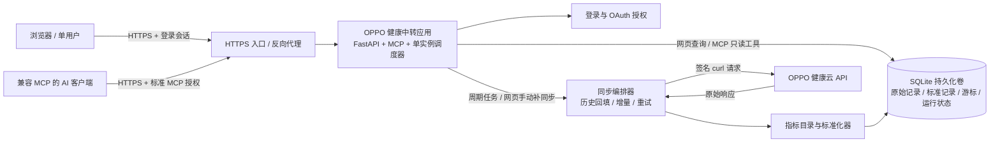
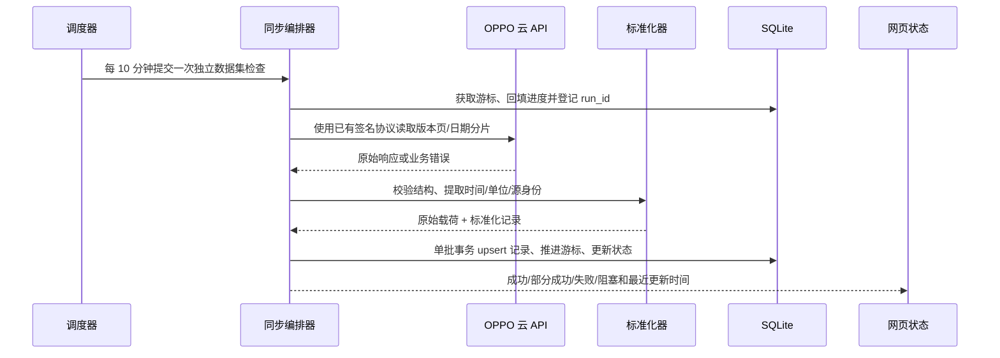
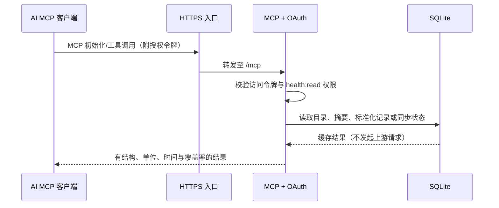

# OPPO 健康云中转平台实施落地方案

> 文档状态：实施基线（供后续开发与上线执行）
> 版本：1.0
> 编制日期：2026-10-21（北京时间）
> 本文只定义建设方案；本阶段不修改程序、不连接服务器、不部署。

## 1. 目标、现状与边界

### 1.1 目标

把当前面向本机运行的 OPPO 健康云 MCP 脚本改造为单用户服务器中转平台。服务运行在用户指定的 `172.245.39.168` 上，周期性从 OPPO 健康云拉取本人授权的数据并缓存在服务器；本人通过有登录保护的网页查看；AI 通过标准远程 MCP 读取整理后的缓存数据。

### 1.2 当前仓库现状

| 项目 | 当前状态 | 落地影响 |
|---|---|---|
| 云端请求 | `cloud_mcp.py` 实现签名、curl 请求、65 个独立数据集的拉取 | 保留经真实联调验证的请求签名和 curl 传输逻辑，抽成可测试的客户端模块 |
| MCP | 本机 stdio，暴露 `cloud_sync`、`cloud_query`、`cloud_analyze`、`cloud_status` | 改为远程 MCP；旧工具不再向 AI 暴露 |
| 缓存 | SQLite `cloud_data(metric,date,payload,fetched_at)` | 当前主键缺少明确稳定源记录 ID；键值相同的记录可能覆盖，难以可靠表示同日多条记录；新库须按源记录身份保存明细 |
| 同步 | 调用 MCP 工具时按指标拉取，无常驻定时调度 | 增加首轮历史回填和服务器定时增量任务 |
| 前端 | 无 | 新建中文单页数据看板 |
| 配置/密钥 | `auth.json` 是本机忽略文件，不在 Git 中 | 在服务器以只读密钥挂载或受限文件保存，不写入仓库、镜像或日志 |

当前枚举包含 65 个独立指标和两个组合入口（`stress`、`physical_mental`），共 67 个 MCP 选项。组合入口由子数据集聚合，不重复发起云端请求。`sport_file` 需要应用运行时生成的 `encryptKeyEnc`，目前不可取；`sport_record` 当前只代表版本索引，不代表解密后的运动轨迹。健康档案等位于独立 AI Health 域名、尚未实现密钥协商的接口不纳入本期。空响应表示“本次没有记录”，不能被解释为账号没有该类健康数据。

### 1.3 固定决策与本期边界

- 单用户、个人私有部署；所有服务进程和数据库在服务器上，不依赖个人电脑常驻。
- 首次尽可能回填最近 **365 天**；之后所有当前可同步的独立数据集都进入默认 **10 分钟**同步周期。两个周期值均可由配置文件调整。
- 使用 SQLite 和持久化数据卷；暂不建设多用户、组织权限或 PostgreSQL 集群。
- 网页登录受保护；远程 MCP 使用标准协议与只读授权；MCP 不提供同步、写入或删除工具。
- 数据目录将原始云端载荷保留在服务器内部，同时向网页和 MCP 提供有语义、带单位及来源的标准化数据。
- 不输出诊断、治疗、疾病风险判断；显示源数据和描述性统计，不把腕温相对基线误称为体温。
- 域名和证书不写死在程序中；部署通过公开地址和 TLS/反向代理配置接入。
- 本期交付为可部署软件、配置样例、测试和运行手册；密钥和实际证书只在服务器配置。

## 2. 总体架构



### 2.1 运行进程与模块边界

首版使用一个 Docker Compose 应用容器，容器内以单个 Uvicorn worker 运行 Web API、MCP ASGI 应用和一个后台调度协程。单 worker 是防止重复启动多个 10 分钟任务的明确约束；云端同步调用放入线程池执行，避免阻塞 Web/MCP 事件循环。TLS 代理可与应用同一 Compose 项目部署，也可使用服务器已有代理。

建议模块边界如下，具体包路径在编码阶段按项目构建文件一次性落实，不要求为模块边界新增多个服务进程：

| 模块 | 职责 | 不应承担的职责 |
|---|---|---|
| 配置与密钥加载 | 读取 TOML、服务器密钥、OPPO 认证；启动时校验必填项 | 打印或返回密钥明文 |
| OPPO 客户端 | 生成签名、执行 curl、解析 HTTP/业务错误 | 持有调度状态、写 UI 专用格式 |
| 同步编排 | 初次回填、周期增量、并发锁、重试、进度状态 | 直接拼接前端响应 |
| 指标目录/标准化 | 指标元数据、单位/时间转换、事件展开、来源标记 | 猜测未知字段单位或医学结论 |
| SQLite 仓储 | 事务、幂等 upsert、分页、迁移、保留期清理 | 执行云请求 |
| Web/API 与登录 | 网页所需接口、会话、CSRF、手动同步任务排队 | 把未授权数据暴露给浏览器 |
| MCP | 注册只读工具、输入校验、OAuth 授权、标准化结果 | 触发云端同步或暴露原始认证信息 |
| 前端 | 概览、图表、明细、同步状态和登录交互 | 直接访问 SQLite、直连 OPPO 云 API |
| 运维/部署 | 容器、卷、反向代理、健康检查、备份 | 把密钥写入镜像或提交到 Git |

### 2.2 云端同步时序



### 2.3 AI 查询时序



## 3. 同步、调度和失败处理

### 3.1 首次 365 天回填

1. 启动后检查 OPPO 认证；认证缺失或无效时进入 `blocked_auth`，Web、MCP 服务仍可启动，但无伪造缓存。
2. 对版本接口，从最早保留日期对应的游标开始分页，逐版本获取正文；游标和分页状态在每批提交后持久化，容器重启后续跑。
3. 对日期范围接口按北京时间自然日分片。已知部分 v5 pull 接口单次跨度超过一天会返回 `23103`，因此这类端点固定按一天请求；若其他端点有更严格限制，由指标策略配置声明。
4. 每批先写入原始记录与标准化记录，再在同一事务内推进该指标回填游标，保证进程崩溃不会出现“游标已前移但数据未落库”。
5. 回填不阻塞网页或 MCP；每个指标展示 `backfilling`、覆盖日期、已处理分片、最近错误。回填完成后进入周期增量。

### 3.2 10 分钟周期增量

- 调度器每 600 秒生成一个“检查全部独立数据集”的计划。每个源数据集在一轮中只处理一次；组合指标由子数据集派生，不单独请求。
- 默认单个上游请求并发数为 1、请求间隔 1000 ms；二者可在配置中调整。其目的是避免 67 类数据集同时突发请求。若一轮超过 10 分钟，不允许重叠执行；新一轮合并为一个待处理周期，并在状态中显示延迟/积压，而不是启动第二个同步器。
- 有版本游标的指标用持久化 `modifiedTimestamp`/`modifiedTime` 追踪增量。无游标的时间序列接口默认重查最近 7 个北京时间日，用稳定记录键 upsert，以接收延迟上报和近期修订；具体端点可在指标目录覆盖该窗口。
- 只返回最新状态的静态/目标类接口按其接口语义更新当前快照，不重复累积为历史测量。
- 首轮回填和周期增量使用同一个记录身份规则；相同上游记录不会因重试或重查生成多条。

### 3.3 请求重试与错误分层

| 情况 | 处理 |
|---|---|
| DNS、连接重置、超时、HTTP 429/5xx | 最多重试 3 次，退避 2/5/15 秒；若响应包含 `Retry-After`，优先遵循它 |
| `10103` 网关/TLS 指纹问题 | 当前项目需保留 curl 传输指纹；记录端点和错误码，不对同一请求快速循环重试 |
| `10100` 验签/多余头问题 | 作为请求构造错误停止该指标本轮，避免重复打云端；日志不包含 token/signature |
| `23103` 日期范围限制 | 将请求缩小为单个北京时间自然日后重试；仍失败时记录为该分片失败 |
| token 失效/认证缺项 | 设置 `blocked_auth`，要求更新服务器密钥后手动重试 |
| 单指标失败 | 其余指标继续运行；本轮标为 `partial`，记录失败指标和错误码 |
| 成功但空响应 | 记为成功且 `rows_received=0`，不推断账号无此数据 |
| 进程退出/容器重启 | 依赖事务和已保存的游标/分片从最后确认点续跑 |

运行状态枚举：`queued`、`backfilling`、`running`、`success`、`partial`、`failed`、`blocked_auth`、`blocked_capability`、`skipped_busy`。每轮生成不可含个人数据的 `run_id`。

### 3.4 幂等、时间和留存

- 优先使用上游稳定 ID；若端点无 ID，按指标适配器生成 `source_key`：上游版本/修改时间、事件起止时间、设备/类型等可用标识组合。若仍无稳定标识，使用规范化 JSON 的 SHA-256 作为重复响应兜底键，并保留修改版本字段用于更新。
- 所有绝对时间以 UTC 毫秒存储；对外派生 `Asia/Shanghai` 显示时间和自然日。数值型时间单位必须在指标适配器定义为秒或毫秒，不靠猜测。
- 可确定事件时间的测量/事件按北京时间记录日保留滚动 365 天；无事件时间的快照用 `fetched_at` 保留滚动 365 天。清理仅作用于数据库中过期记录，不删除配置、日志或用户文件。
- SQLite 启用 WAL、外键、busy timeout 和事务；高频读查询不持有长写锁。一次同步批次限制大小，禁止将一年全部数据放进单个事务。

## 4. 数据目录与标准化模型

### 4.1 统一标准化记录

原始响应单独保留并仅由服务内部访问。网页和 MCP 默认只读标准层：

```json
{
  "record_id": "稳定的内部记录标识",
  "metric_key": "steps_stat",
  "display_name": "步数统计",
  "category": "activity",
  "record_kind": "daily_summary",
  "recorded_at": "2026-10-21T03:10:00Z",
  "local_date": "2026-10-21",
  "value": null,
  "unit": null,
  "attributes": {"totalSteps": 8200, "totalDistance": 5400},
  "source": {"dataset": "steps_stat", "source_type": "oppo_cloud"},
  "synced_at": "2026-10-21T03:12:00Z"
}
```

- `value/unit` 用于单值型指标；多字段统计和复杂事件使用 `attributes`，不得把总步数、睡眠分期、心电图事件等压成一个含义不明的数字。
- `record_kind` 使用 `observation`（采样）、`interval`（时间段）、`daily_summary`（日统计）、`event`（事件/预警）、`index`（评分/指数）、`snapshot`（目标/快照）之一。
- `unit` 必须有字段级映射依据。源接口未标单位时返回 `unit: null` 并在目录标注“源单位未确认”；不得推测换算。例：确认可按原代码换算的体重才提供 kg；心率 bpm、血氧 %、呼吸率 次/分、睡眠时长 min 等也须以接口字段/真实样本验证后启用。
- 保留 `source_key`、原始字段名/字段路径和源修订时间，支持追溯；原始 JSON 不包含在 MCP 默认响应中。

### 4.2 SQLite 逻辑表

| 表 | 关键字段 | 用途 |
|---|---|---|
| `raw_records` | `metric_key, source_key, source_modified_at, event_time, payload_json, fetched_at`；唯一键 `(metric_key, source_key)` | 原始上游记录；重复请求 upsert |
| `health_records` | `record_id, metric_key, category, record_kind, event_time, event_end_time, local_date, value_num, unit, attributes_json, source_key, synced_at` | 网页/MCP 统一查询；按日期和指标建立索引 |
| `metric_catalog` | `metric_key, display_name, category, record_kind, unit_definition, time_semantics, caveat, sync_strategy, capability_status` | 目录与 UI/MCP 参数校验来源 |
| `sync_state` | `metric_key, cursor, backfill_from, backfill_to, status, last_started_at, last_success_at, last_error_code` | 每指标续跑和状态 |
| `sync_runs` | `run_id, trigger, started_at, ended_at, status, metric_counts_json` | 周期/手动任务审计和监控 |

### 4.3 现有指标目录初始分组

以下为目录首版。每项实施时都要落 `display_name/category/record_kind/time_semantics/unit_definition/caveat/capability_status`。时间字段按该指标适配器优先级取值；通用候选顺序为业务 `date`、测量时间、区间开始时间、事件时间、修改时间。单位不明时明确标未确认，不从标签猜单位。

#### 活动与运动

| 指标键 | 中文名 | 数据类型与时间语义 | 单位/注意事项 |
|---|---|---|---|
| `steps` | 步数记录 | 时间序列/活动区间 | 步数、距离、消耗、运动模式按源字段分别标单位 |
| `steps_detail` | 步数明细 | 活动区间，含起止时间 | `steps` 为计数；距离/消耗按源字段单位 |
| `steps_stat` | 步数日统计 | 日汇总 | 步数、距离、消耗、时长分别保留单位和目标状态 |
| `sport_stat` | 运动统计 | 日/运动模式汇总 | `sportMode` 作为分类，数值采用源单位 |
| `sport_record` | 运动记录版本索引 | 版本元数据 | 仅表示版本索引，不当作轨迹明细 |
| `sport_file` | 加密运动文件 | 文件/轨迹数据 | 当前缺应用动态 `encryptKeyEnc`，标 `blocked_capability`，不伪造轨迹 |
| `sport_goal` | 运动目标 | 目标快照/有效期 | 数值和单位按目标类型解释 |
| `exercise_intensity` | 运动强度 | 日统计/强度区间 | 强度等级及时间按接口原值和目录解释 |
| `tumble` | 跌倒/跌倒检测记录 | 事件 | 事件时间及类型按源字段保存 |
| `sedentary` | 久坐提醒 | 提醒事件/时间段 | 保留提醒时间和源事件属性 |
| `app_usage` | 应用使用统计 | 日期统计 | 使用时长使用源单位；包名作为分类数据处理 |
| `app_usage_detail` | 应用使用明细 | 使用时间段 | 保留包名、区间和源时长单位 |

#### 睡眠与恢复

| 指标键 | 中文名 | 数据类型与时间语义 | 单位/注意事项 |
|---|---|---|---|
| `sleep` | 睡眠日记录 | 夜间/日汇总 | 总睡眠和分期时长优先按源单位（通常为分钟，验证后登记） |
| `sleep_stat` | 睡眠统计 | 日汇总 | 入睡/起床时间、分期、评分按字段分别保存 |
| `sleep_status` | 睡眠状态/分期 | 时间区间/阶段事件 | 保留阶段、类型、开始结束时间和版本 |
| `sleep_index` | 睡眠指数 | 评分/恢复指标 | 指数和范围保留源定义，不进行医学解释 |
| `sleep_rr` | 睡眠 RR 间隔 | 序列/区间数据 | RR 数值按源单位；嵌套列表逐点保存或作为结构化属性 |
| `sleep_advice` | 睡眠建议 | 文本/建议事件 | 原文内容视为敏感数据，不用于诊断推断 |
| `sleep_hr_stat` | 睡眠心率统计 | 夜间统计 | 心率类字段使用经确认单位，通常 bpm |
| `snore_osa_detail` | OSA 模型明细 | 区间/模型事件 | 保留模型原字段及置信/分类语义 |
| `snore_osa_sum` | OSA 汇总 | 夜间汇总 | 不把模型结果表述为临床诊断 |
| `snore_env_noise` | 打鼾环境噪声 | 区间/采样 | 声学单位仅在源接口明示后展示 |
| `snore_feature` | 打鼾特征 | 区间/特征记录 | 保留特征结构及时间范围 |
| `snore_stat` | 鼾声统计 | 日/夜间汇总 | 字段和计数按源定义 |
| `sensor_osa` | OSA 传感器数据 | 传感器事件/区间 | 保留源数据类别、时间和单位 |
| `breath_rate` | 呼吸率 | 区间内采样序列 | `respiratoryRate` 展开为逐点记录，单位经目录确认 |

#### 心血管、血氧及相关测量

| 指标键 | 中文名 | 数据类型与时间语义 | 单位/注意事项 |
|---|---|---|---|
| `heart_rate` | 心率记录 | 心率采样 | bpm（经源字段确认）；区分测量类型 |
| `heart_rate_detail` | 心率明细 | 版本化采样明细 | 保留心率类型、测量时间及修改时间 |
| `heart_rate_stat` | 心率统计 | 日统计 | 按源字段保留均值/分位等定义，不自行称作静息心率 |
| `heart_rate_warning` | 心率预警 | 预警事件 | 保留触发时间、类型和源阈值 |
| `blood_oxygen` | 血氧记录 | 血氧采样 | 饱和度字段可标 %；类型和测量上下文需保留 |
| `blood_oxygen_detail` | 血氧明细 | 版本化采样 | 保留测量类型和修订时间 |
| `blood_oxygen_stat` | 血氧统计 | 日统计 | 数值/合理范围按源字段解释 |
| `blood_oxygen_warning` | 血氧预警 | 预警事件 | 事件而非普通连续样本 |
| `blood_oxygen_origin` | 血氧设备原始数据 | 设备原始记录 | 不转换未知单位；保留设备来源 |
| `blood_pressure` | 血压记录 | 测量事件 | 收缩压/舒张压按源单位（常见 mmHg，验证后登记） |
| `blood_pressure_stat` | 血压统计 | 日/周期统计 | 统计口径按源字段保留 |
| `atrial_fibril` | 房颤筛查记录 | 测量/筛查事件 | 保留源分类和结论文本，不做临床诊断 |
| `atrial_fibril_warning` | 房颤预警 | 预警事件 | 与筛查测量分开存储 |
| `cardiovascular` | 心血管评估 | 评估事件/指数 | 保留源评估项、时间和解释文本 |
| `ecg` | 心电图记录 | ECG 元数据/测量事件 | 当前主要为记录元数据；未接入的波形不展示为已获取 |
| `hrv` | 心率变异性 | 时间序列测量 | `heartRateVarValue` 等字段；单位以接口定义确认，常见为 ms |

#### 身体测量与代谢

| 指标键 | 中文名 | 数据类型与时间语义 | 单位/注意事项 |
|---|---|---|---|
| `weight` | 体重 | 测量事件 | 现有分析按源值/1000 转 kg；实施时用真实样本验证并统一保存 kg |
| `weight_target` | 体重目标 | 目标快照/有效期 | 目标值、单位和生效区间分别保留 |
| `wrist_temperature` | 腕温统计 | 日统计/个人基线变化 | 表示相对个人基线的变化，不是体温计测得的绝对体温 |
| `wrist_temperature_detail` | 腕温明细 | 测量事件 | 维持源温度/变化语义，不混同绝对体温 |
| `blood_sugar` | 血糖记录 | 测量事件 | 单位按源字段；不在未确认时自动换算 mmol/L/mg/dL |
| `blood_sugar_stat` | 血糖统计 | 日/周期统计 | 保留餐前/餐后或测量类型等上下文 |
| `blood_sugar_warning` | 血糖预警 | 预警事件 | 不据此生成疾病判断 |
| `vitamin` | 维生素记录 | 测量/健康记录 | 指标、数值和单位按源字段目录化 |

#### 压力、身心及其他健康

| 指标键 | 中文名 | 数据类型与时间语义 | 单位/注意事项 |
|---|---|---|---|
| `stress_detail` | 压力明细 | 时间序列/区间 | `stressValue` 为源评分；RMSSD/SDNN 等字段独立登记单位 |
| `stress_stat` | 压力统计 | 日统计 | 与明细分开保存 |
| `stress` | 压力组合数据 | 组合视图 | 由 `stress_detail` + `stress_stat` 聚合，不单独请求云端 |
| `physical_mental_detail` | 身心健康明细 | 时间序列/复合记录 | 嵌套数据逐项登记时间、字段与来源 |
| `physical_mental_stat` | 身心健康统计 | 日统计 | 指标按源定义展示 |
| `physical_mental_achievement` | 身心健康目标/成就 | 日/目标事件 | 保留日期、目标和成就状态 |
| `physical_mental` | 身心健康组合数据 | 组合视图 | 由明细、统计和成就数据派生 |
| `hearing` | 听力记录 | 测试事件 | 分贝/评分单位仅按接口定义登记 |
| `hearing_stat` | 听力统计 | 统计记录 | 与单次测试分开 |
| `cervical_stat` | 颈椎训练统计 | 日/训练汇总 | 时长、次数等按源单位 |
| `cervical_action` | 颈椎训练动作 | 动作事件/序列 | 保留动作、次数、持续时间和时间戳 |
| `insight` | 健康洞察原始结果 | 复合快照 | 作为源端文本/结构展示，不作诊断或二次推断 |

#### 女性健康、日照与环境

| 指标键 | 中文名 | 数据类型与时间语义 | 单位/注意事项 |
|---|---|---|---|
| `physiological_cycle` | 生理周期 | 周期区间/事件 | 日期语义和周期阶段按源数据解释，限制访问 |
| `physiological_symptoms` | 生理症状 | 症状事件 | 敏感健康数据，默认不展示在公共概览摘要 |
| `ovulation` | 排卵信息 | 日期/周期事件 | 只展示源端提供的信息，不额外推断生育结论 |
| `sunshine` | 日照记录 | 日/时间段记录 | 时长和强度使用源单位 |
| `sunshine_stat` | 日照统计 | 日统计 | 统计口径按源字段定义 |

以上目录同时包含指标本身和其语义元数据；实施者不得为了“统一”而删掉源数据中的阶段、类型、设备、目标、预警等上下文。

### 4.4 汇总口径


概览和 AI 摘要采用指标目录中显式配置的计算规则，不用一套通用平均值解释所有健康指标：

- 上游已有日统计时，优先展示该日统计；同一日期存在多版本时选源修订时间最新的一条，不把统计记录与明细再次相加。
- 步数明细仅在没有有效 `steps_stat` 日统计时作为回退；按源记录 ID 去重，只累加目录标注为可累加且时间区间不重叠的数据，并在结果注明 `derived_from=steps_detail`。
- 连续数值采样只有目录声明为 `observation` 且字段/单位已验证时才计算 count、min、max、mean；类别型、指数型和预警型字段不做平均。单位不同的值绝不混算。
- 区间和阶段数据按源记录展示；除非指标目录定义了专用算法，不自行累加重叠区间或把阶段比例解释成质量结论。
- 事件型数据仅可统计事件数量并列出源类型；不推导疾病概率。每个摘要项附 `record_count`、时间窗口、单位和来源/派生方法，便于 AI 判断口径。

### 4.5 数据迁移


启动时检测旧 `cloud_data` 表。迁移前用 SQLite backup API 生成一致性备份；按可提取时间和 payload 导入新表，以新 `source_key` 去重。旧表同指标同日期可能已经覆盖更早记录，无法从旧库恢复的缺失历史通过首次云端回填补齐。迁移以版本号记录，迁移失败时停止写入并保留旧库和备份，不自动删除任何数据库文件。

## 5. Web/API 与前端

### 5.1 页面信息架构

1. **概览页：** 日期窗口（7/30/90/365 天）、最近测量时间、各类别数据覆盖、关键指标趋势；不把“有记录”表达为健康结论。
2. **指标浏览：** 左侧类别/指标目录，按日期筛选；显示数值、单位、采样类型及来源时间。
3. **指标详情：** 时间序列图（适用时）、日汇总和事件明细表；嵌套结构以可展开字段查看。
4. **同步状态：** 总体成功/部分成功/失败、回填进度、单指标最近成功和错误码；登录用户可选指标执行增量补同步或继续回填。
5. **登录/会话：** 单用户登录、退出和过期提示；无登录状态不返回健康数据。

实现采用 React + TypeScript + Vite，图表使用 ECharts；生产静态资源由同一应用或 TLS 代理提供，不依赖外部 CDN。布局适配桌面和手机，默认中文、北京时间显示。

### 5.2 REST 路由

所有业务 API 位于 `/api/v1`，同源访问；不开放未认证的健康数据接口。

| 路由 | 方法 | 权限 | 作用 |
|---|---|---|---|
| `/api/v1/auth/session` | `POST` | 未登录 | 登录；失败统一返回 401，不区分账号是否存在 |
| `/api/v1/auth/session` | `GET` | 登录 | 返回当前会话状态和过期时间，不返回 token |
| `/api/v1/auth/session` | `DELETE` | 登录 | 注销并吊销会话 |
| `/api/v1/overview` | `GET` | 登录 | 参数 `days=1..365`，返回概览和覆盖情况 |
| `/api/v1/metrics` | `GET` | 登录 | 参数 `category` 可选，返回指标目录 |
| `/api/v1/metrics/{metric_key}/records` | `GET` | 登录 | 参数 `start_date/end_date/cursor/page_size`，读取标准化记录 |
| `/api/v1/sync/status` | `GET` | 登录 | 查询整体或 `metric_key` 同步状态 |
| `/api/v1/sync/jobs` | `POST` | 登录 + CSRF | 仅排队；指定指标列表和 `incremental/backfill` 模式，返回 `job_id` |
| `/api/v1/sync/jobs/{job_id}` | `GET` | 登录 | 查询手动任务进度 |
| `/healthz`、`/readyz` | `GET` | 健康探针 | 存活探针与配置/数据库就绪探针；不输出密钥或数据 |

分页默认 100、上限 500；结果按 `event_time DESC, record_id DESC` 稳定排序，返回不透明 `next_cursor`。开始/结束日期采用 `YYYY-MM-DD`，按北京时间自然日解释且两端包含；最多 365 天。非法日期、超范围、未知指标、无权访问均返回固定错误码和简短说明，不回显内部异常或原始 payload。

### 5.3 页面状态和错误展示

- 首次加载：骨架状态；空结果：显示“该区间缓存中暂无记录”和最近成功同步时间。
- 单项失败但其他成功：明确显示“部分数据未更新”，列出指标和错误码。
- token 过期：显示需要更新认证，不清空原有缓存。
- 回填/同步进行中：显示进度、开始时间和是否排队，不允许重复点击造成并发任务。
- 缓存过旧：仍可查看已有缓存，同时注明最后更新时间；不能将缓存陈旧伪装成实时数据。
- 记录列表保持单位、时间和来源上下文；对超长文本和复杂 attributes 可展开，不直接展示原始认证头或敏感内部字段。

## 6. MCP 接口契约

### 6.1 传输与授权

远程 MCP 路径固定 `/mcp`，采用官方 Python MCP SDK 2.x 的标准 Streamable HTTP 传输，不自定义 JSON-RPC 包装协议。认证按 OAuth 2.1 授权码 + PKCE、资源元数据和 bearer access token 设计；MCP 仅授予 `health:read` scope。网页 cookie 与 MCP bearer token 分开，不互相透传。具体 AI 客户端只需配置 MCP 服务地址并完成一次标准授权。

### 6.2 工具定义

#### `get_health_overview`

- 参数：`days` 整数，默认 7，范围 1–365。
- 返回：`period`（起止日期和时区）、每个类别/指标的摘要、数据覆盖天数、最近更新时间、缺失/过期指标列表。
- 只返回缓存中实际存在的记录；不生成医学判断，不从无数据推断“正常”。

#### `query_health_data`

- 参数：`category` 可选；`metrics` 可选数组；`start_date`、`end_date` 可选但必须成对传入；`page_size` 默认 100、最大 500；`cursor` 可选。
- 过滤规则：同时给类别和指标时取交集；无过滤条件时要求提供日期范围。最多查询 365 天。
- 返回：`records`、`has_more`、`next_cursor`、查询区间和缓存新鲜度。每条记录包含 `record_id/metric_key/display_name/category/record_kind/recorded_at/local_date/value/unit/attributes/source/synced_at`；不含 `payload_json`。

#### `list_health_metrics`

- 参数：`category` 可选。
- 返回：指标 key、中文名称、类别、类型、时间语义、单位定义、注意事项、能力状态和最近成功同步时间。未接入原因（例如缺动态密钥）明确返回，不把它登记为普通空结果。

#### `get_sync_status`

- 参数：`metric_key` 可选。
- 返回：整体运行状态、回填/增量模式、周期配置、当前运行/排队任务、各指标最后成功时间、积压状态和错误码；不返回认证材料、完整请求或健康读数。

### 6.3 MCP 错误语义

| 错误码 | 行为 |
|---|---|
| `INVALID_ARGUMENT` | 日期、指标或分页参数不合法 |
| `DATE_RANGE_EXCEEDED` | 查询范围超过 365 天 |
| `CURSOR_INVALID` | cursor 无效/过期，要求从第一页重查 |
| `AUTH_REQUIRED` / `SCOPE_REQUIRED` | 未完成 OAuth 或没有只读 scope |
| `METRIC_NOT_FOUND` | 指标不在目录中 |
| `METRIC_UNAVAILABLE` | 指标当前因能力缺失而不可同步，附非敏感原因 |
| `NO_DATA` | 合法查询但缓存没有记录，返回空 records 而非错误 |
| `CACHE_STALE` | 作为 freshness 状态随结果返回，不丢弃可用旧缓存 |

`cloud_sync`、`cloud_query`、`cloud_analyze`、`cloud_status` 从 MCP 工具注册表移除；相关云端拉取逻辑只能由服务器内部同步服务调用。所有新工具标注只读、非破坏性。

## 7. 配置、密钥和安全

### 7.1 非秘密配置

采用根目录 `config.toml`（容器挂载为只读），首版默认值如下：

```toml
[server]
host = "0.0.0.0"
port = 8000
public_base_url = ""
trusted_proxy_cidrs = ["127.0.0.1/32"]

[storage]
database_path = "/data/health.sqlite3"
retention_days = 365

[sync]
interval_minutes = 10
initial_history_days = 365
fallback_lookback_days = 7
max_concurrent_requests = 1
min_request_interval_ms = 1000
max_retry_attempts = 3

[mcp]
path = "/mcp"
read_scope = "health:read"

[logging]
level = "INFO"
```

反向代理在服务器实际配置中将 `public_base_url`、受信代理网段和 TLS 证书注入；程序不写死主机名。`max_concurrent_requests=1` 和 1000ms 间隔是初始保守值，可通过配置调整。

### 7.2 秘密材料

- OPPO `token`、`token_auth_id`、`ssoid` 及可选 `encrypt_key_enc`：服务器只读 secret 文件或 Docker secret；复用当前文件字段名，绝不放入 `config.toml`。
- 网页管理员账号：用户名与 Argon2id 密码哈希；原始密码只在部署密钥输入阶段使用，不写配置库。
- OAuth 签名/加密密钥：使用独立随机密钥文件，限制为容器只读挂载；支持令牌撤销/密钥轮换说明。
- 环境变量只用于传递 secret 文件路径，不把 secret 值写进 Docker Compose、镜像层或容器命令行。

### 7.3 安全控制

- 只接受 HTTPS 对外服务；应用监听容器私有网络，宿主机不直接公开 8000。信任代理头仅限配置的代理网段，防止伪造外部 scheme/IP。
- Web 会话 cookie 设置 `HttpOnly`、`Secure`、`SameSite=Strict`；登录失败限速；所有写操作校验 CSRF token。
- MCP OAuth 访问令牌短期有效并支持刷新/吊销；token 校验 audience、scope 和过期时间。MCP 默认只读。
- 登录页和 API 同源；不开放通配 CORS，不允许浏览器直连上游 OPPO。
- 日志只记录 run_id、指标 key、端点代号、错误码、耗时和行数；对 Authorization、token、签名、个人记录 payload 进行全量脱敏。
- 周期健康数据、女性健康、睡眠和身心数据按最高敏感级保护；接口不给未登录用户返回缓存统计数量，以免侧信道泄露。

## 8. 部署拓扑与运维

### 8.1 Docker Compose 拓扑

```text
Internet
  └─ HTTPS reverse-proxy (Caddy 或现有代理，证书/域名通过运行配置)
       └─ internal network
            └─ oppo-health-app (非 root，1 worker，FastAPI + MCP + scheduler)
                 ├─ /data/health.sqlite3 (持久卷)
                 ├─ /run/secrets/oppo-auth.json (只读 secret)
                 └─ /run/secrets/app-keys (只读 secret)
```

Compose 要求：应用镜像固定版本 tag；`restart: unless-stopped`；配置和 secret 只读挂载；仅代理容器绑定公网端口；数据库卷独立持久化；容器有 `/healthz` 检查、CPU/内存限制和日志轮转。前端由 Vite 构建后纳入应用静态资源，不使用运行时 CDN。应用镜像内安装系统 curl，以维持现有上游 TLS 行为。

### 8.2 首次部署顺序

1. 确认服务器时间同步、Docker/Compose、磁盘空间和反向代理入口；创建受限的配置、secret、数据、备份目录。
2. 将 OPPO 认证安全写入服务器 secret；不通过聊天、Git 或公开日志传输。
3. 构建并启动容器；先验证 `/healthz`、数据库可写、OAuth discovery 和 `/mcp` 工具列表，再验证网页登录。
4. 手动启动一次指标范围受控的历史回填；确认状态页、分页、限速、持久化与失败恢复后，开启完整 365 天回填和 10 分钟调度。
5. 首轮回填结束后，从网页检查样本、时间、单位和覆盖率；用目标 AI 客户端完成 MCP 授权并查询概览及分页明细。
6. 记录镜像 tag、配置版本、迁移版本、运行状态和最近成功同步时间；部署结束后撤销临时凭据并轮换暴露过的 secret。

域名/证书仅作为运行配置或外部代理职责；代码和文档不绑定具体域名。真实公网上线必须在服务器侧配置可被客户端信任的 HTTPS 证书。

### 8.3 备份、恢复和回滚

- 每日使用 SQLite backup API 生成一致性备份，权限 `0600`；本机默认保留最近 7 份。敏感备份不自动上传第三方位置；需要异地备份时再由用户配置加密目标。
- 数据库迁移前额外备份；恢复操作先停止 app 容器、恢复到临时路径并校验数据库，再切换数据库路径。任何恢复都不覆盖唯一备份。
- 回滚使用上一版镜像 tag 和上一版配置；若数据库已前向迁移，必须先执行兼容性检查或从迁移前备份恢复。
- 停容器使用 `docker compose stop`/`down`，严禁使用会删除数据卷的 `down -v`。文档、配置、备份和数据库均不得作为普通更新清理对象。

### 8.4 监控和排障

- `/healthz` 只判断进程；`/readyz` 检查配置、SQLite 和 secret 文件可读，不触发云端请求。
- 页面状态提供最后一次全局运行、指标成功率、最旧待回填日期、最近错误码和下一轮计划时间。
- 关键告警条件：认证阻塞；连续 3 轮无任何指标成功；积压超过 30 分钟；数据库不可写/磁盘余量低；OAuth/HTTPS 配置无效。
- 排障先按错误码区分认证/签名、网关/TLS、业务范围和本地数据库问题；日志中不得请求用户粘贴 token 或原始健康载荷。

## 9. 建议代码结构与实施阶段

```text
cloud_mcp.py                 # 迁移期间兼容入口；完成后只负责启动新应用
src/oppo_health/config.py    # TOML、secret 校验与配置模型
src/oppo_health/oppo/        # 签名、curl 客户端、端点响应解析
src/oppo_health/catalog/     # 65 个数据集 + 2 个组合目录、字段映射
src/oppo_health/sync/        # 回填、增量、限速、重试、状态与调度
src/oppo_health/storage/     # SQLite schema、迁移、仓储、保留期和备份
src/oppo_health/web/         # 登录、REST API、CSRF、手动任务队列
src/oppo_health/mcp/         # OAuth Resource Server、工具注册和 MCP adapter
frontend/                    # React + TypeScript + Vite + ECharts
deploy/                      # Dockerfile、Compose、反向代理样例
 tests/                       # 单元、集成、协议和 UI E2E
```

实施顺序和依赖：

| 阶段 | 交付 | 依赖/退出条件 |
|---|---|---|
| 0. 配置与测试骨架 | Python 依赖锁定、TOML 校验、日志脱敏、mock API fixture | 可离线启动单元测试 |
| 1. 数据层 | 指标目录、标准化器、SQLite 新表与迁移 | 目录覆盖全部 65+2 项；迁移/幂等测试通过 |
| 2. 同步服务 | OPPO 客户端适配、分片回填、版本游标、限速/重试、状态查询 | mock 365 天回填可断点续跑，不重复写入 |
| 3. Web/API 与登录 | FastAPI 路由、会话/CSRF、手动任务队列 | 未登录不能读取；接口契约测试通过 |
| 4. 前端 | 概览、指标详情、同步页、响应式状态 | 使用 mock API 完成页面和主要交互 E2E |
| 5. MCP | OAuth、远程 MCP、四个只读工具 | 标准 MCP 客户端可授权、发现和调用；无同步工具 |
| 6. Compose 与服务器验收 | 镜像、数据卷、HTTPS proxy、备份/恢复手册 | 容器重启保留数据、健康探针正常、目标 AI 查询通过 |

## 10. 测试计划

### 10.1 单元测试

- 65 个独立指标和两个组合指标的目录覆盖、类别、记录类型、同步策略和 capability 状态完整性。
- 时间解析：秒/毫秒、日期字符串、北京时间跨日、区间开始/结束、缺失时间、异常值；未知时区和单位必须显式处理。
- 结构解析：列表、dict、`dataList`、嵌套列表、空响应、类型不符；HRV/压力的嵌套记录保留 source 和原始偏移信息。
- 幂等键：相同响应重复写入不增加行；相同 source ID 的修订更新原记录；不同设备/测量不互相覆盖。
- 单位映射：已确认单位可转换；未知单位不得转换或显示成猜测值；腕温相对基线 caveat 始终保留。

### 10.2 同步与存储集成测试

- 用模拟云端逐日完成 365 天回填；测试分页上限、`hasMore`、游标不前进、进程中止后续跑。
- 确认 `23103` 会拆为单日请求；模拟 `10100`、`10103`、429、5xx、超时、token 失效、成功空集和部分指标失败。
- 10 分钟时钟模拟：全部独立数据集进入队列、组合指标不重复请求、每轮无重入、超时轮次合并并报告积压。
- 验证增量窗口、静态快照覆盖、365 天清理、手动补同步排队、写事务失败时游标不前移。
- 从旧 `cloud_data` 表迁移，确认迁移前备份可读、兼容字段被导入、旧数据不可恢复部分由回填补足且不删除旧文件。

### 10.3 Web/MCP/安全测试

- Web E2E：登录/退出、会话过期、分类筛选、趋势图、明细分页、无数据、部分失败、认证阻塞、手动任务进度。
- 未认证访问 REST/MCP 被拒；错误密码限速；cookie 属性、CSRF、CORS、代理头信任边界正确。
- MCP：`initialize`、工具发现、OAuth 授权、调用四个工具、分页续查、scope 检查、无同步/写入工具、空数据和 stale 状态返回。
- 所有日志和前端错误快照扫描 token、签名、ssoid、原始 payload，必须无敏感值。
- Docker Compose E2E：启动、健康检查、容器重启、数据卷持久化、备份恢复、上一镜像回滚。

## 11. 验收标准

1. 服务全部运行于目标服务器；无需用户电脑持续在线。
2. 网页和远程 MCP 都要求认证，外部入口使用 HTTPS；无公开的 SQLite、原始 payload 或密钥路径。
3. 首次同步按接口能力回填最近 365 天；回填能中断续跑、记录进度，并按保留策略清理过期记录。
4. 默认 10 分钟调度检查全部可用独立指标；上游健康时无重复记录、无并行重入，延迟和失败在页面及 MCP 状态中可见。
5. 指标目录至少覆盖当前 65 个独立数据集和两个组合视图；未知字段单位为空且标记未确认；不可获取能力明确展示。
6. AI 只看到四个新只读工具返回的标准化数据，无法启动同步或访问 raw JSON；旧四个 `cloud_*` 工具不再注册。
7. 手动同步只能由已登录网页用户排队；任务状态可追踪，重复点击不会产生并行任务。
8. Docker 重启、程序更新或应用迁移不丢数据库；至少完成一次备份恢复演练。
9. 未配置 OPPO 认证、OAuth secret 或有效 HTTPS 运行配置时，服务安全失败并给出不含秘密的修复提示。

## 12. 风险与实施约束

- 10 分钟覆盖全部 65 个源数据集是调度目标，不代表每个指标在上游异常或一次周期超过 10 分钟时都能在 10 分钟内更新；必须以成功时间和积压状态诚实呈现，不得并发加压补偿。
- 上游 token 可能过期；当前认证流程需要人工更新认证材料，首版不尝试逆向应用动态密钥生成逻辑。
- OPPO 接口会因账号、设备、字段版本而返回不同结构；使用真实账号做最终验收时须由用户在服务器提供认证，不将样本健康数据提交 Git。
- 不支持的 AI Health 独立域、加密运动文件、ECG 波形下载/解密保持明确未接入，不纳入本期承诺。
- 若以后出现多用户并发或写入压力超过单 SQLite 实例能力，再单独评估 PostgreSQL；本期不提前引入。
- 所有实施改动按仓库维护约定直接落到目标主分支并及时 commit/push；若远端默认分支与 `main` 不一致，先确认实际分支策略，不擅自改仓库默认分支。

---

**本文完成后的阶段边界：** 只交付本实施文档。程序开发、密钥传输、服务器连接、Docker 安装和服务部署均属于后续阶段。